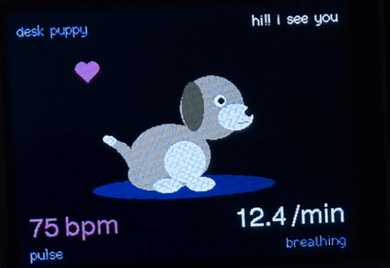

*This is a submission for the [Presage SmartSpectra SDK Challenge](https://dev.to/challenges/presage-2026-11-04)*

## What I Built

Desk Puppy is a small pixel dog that lives on an ESP32 "Cheap Yellow Display" next to my monitor and reacts to my pulse and breathing.

My PC's built-in webcam is the only sensor. The Presage SmartSpectra SDK reads my pulse rate, breathing rate and a chest movement trace from the video, and a small Node program sends four numbers over USB to the display about ten times a second. The puppy turns them into behavior:

* Its tail wags once per heartbeat.
* Its chest rises and falls with my actual breathing trace, not a canned animation.
* When my breathing slows down and my pulse is at its usual level, it closes its eyes and dozes.
* When my pulse is well above my usual level, it gets the zoomies.
* When I hold my breath, after about ten seconds it starts pawing at the glass and tells me to breathe.

I wanted to see how these signals feel off a dashboard. Reading `72 bpm` on a screen is pretty dry, whereas having a little pixel dog match its tail wag to your actual heartbeat feels surprisingly alive.

It is a toy. It does not diagnose, treat or monitor anything, and I would not trust it with a health decision.

## Demo





The video is one take in real time. The left side is a recording of the terminal window running the bridge; the right side is my phone pointed at the display. The webcam is pointed at me and is not shown. Approximate times:

* 0:00 The consent prompt. Nothing has opened the camera yet and the puppy says "waiting for PC".
* 0:08 I type `yes`. The terminal prints the SmartSpectra SDK version and finds the board.
* 0:20 The puppy wakes up. Its chest starts following my breathing, then pulse and breathing rate appear.
* 1:24 I have been holding my breath for about ten seconds. The terminal says "breath held" and the puppy paws at the glass until I breathe again.
* 2:03 I have been breathing slowly. The puppy falls asleep.
* 2:22 I stop the bridge with Ctrl+C, and a few seconds later the puppy goes back to "waiting for PC".

The excited mood (zoomies) is not in this take.

If you want to try it without a camera or an API key, `npm run fake` replays a scripted sequence (calm, held breath, excited, sleepy) through the same logic, and `npm run fake -- --dry-run` does it without the board.

## Code



Two small programs:

* `firmware/` is a PlatformIO project for the display. It draws the puppy into a sprite with [TFT_eSPI](https://github.com/Bodmer/TFT_eSPI) and parses one line of text per update.
* `bridge/` is a Node 24 program for the PC. It runs the SmartSpectra SDK, detects breath holds, decides the puppy's mood and writes to the serial port.

Setup instructions, the parts list and the flashing steps are in the README.

## How It Responds to Human Signals

The system has three pieces:

1. **Camera to bridge.** The Presage SmartSpectra SDK processes video frames locally on my PC and outputs metrics.
2. **Bridge to display.** A Node script turns those metrics into one line of plain text and writes it to the board's serial port (COM5 on my PC) at 115200 baud, about ten times a second.
3. **Display to puppy.** An Arduino sketch on the ESP32 parses each line and updates the puppy's mood and animation.

The line is the whole interface between the PC and the puppy:

```
V,<pulse bpm>,<breaths per min>,<state>,<chest -100..100>
```

The bridge asks the SDK for breathing and cardio metrics and uses three of them: `cardio.pulseRate`, `breathing.rate` and `breathing.upperTrace` (the chest trace).

```js
const sdk = new SmartSpectraSDK({
  apiKey,
  requestedMetrics: [...breathingMetrics, ...cardioMetrics],
  enableTelemetry: false,
});
sdk.on('metrics', (buf) => {
  const m = decodeMetrics(buf);
  const pulse = m.cardio?.pulseRate?.at(-1)?.value;
  const breathing = m.breathing?.rate?.at(-1)?.value;
  const chest = m.breathing?.upperTrace?.at(-1)?.value;
  // ...
});
sdk.useCamera(CameraSelection.byId(camera.id));
sdk.start();
```

**Pulse to tail.** The firmware advances the wag by one full swing per beat, so the tail is a metronome for my heart rate.

**Chest trace to chest.** The trace arrives in arbitrary units. The bridge centers it, scales it by the size of my recent breaths, and uses it to set how far the puppy's chest rises.

**Breath holds.** The SDK lists an apnea metric but marks it unavailable, so I wrote a detector. My first version looked for a flat trace and never fired, because a held breath does not flatten the trace: the breathing wave goes away, but a ripple at about heartbeat rate stays, roughly a third the size of a breath. The version that works smooths the trace over one second to remove that ripple, learns how far the result normally swings over eight seconds while I breathe, and reports a hold when the swing stays under four tenths of that while the SDK still says it can see me. It lets go within a few seconds of the next breath. I found the right measure with a small calibration mode that tells me when to breathe and when to hold and prints how the trace behaved in each phase.

**Moods.** The rules are short:

| Mood | When |
| --- | --- |
| searching | no valid signal |
| breath held | the detector above |
| excited | pulse more than 20 bpm above my session baseline |
| sleepy | breathing under 10 a minute and pulse not raised |
| awake | otherwise |

The baseline is the median of my pulse over the last three minutes of calm. A webcam pulse wanders by ten beats or so while I sit still, so a baseline fixed at the start went stale within minutes. To keep the puppy from flickering between moods at a threshold, each mood is harder to leave than to enter and has to persist for a couple of seconds before it shows.

The SDK also reports why it is unhappy with the view (too dark, face not centered, chest not visible). "No face" sends the puppy looking for me. The other complaints are shown in the terminal as advice while the puppy carries on, but a breath hold is only looked for while the status is OK.

A few things I only learned by using it:

* **Light matters.** The SDK will not start measuring in a dim room. It reports "Increase light on face" and waits, so the bridge shows that message instead of looking frozen.
* **Numbers take a moment.** The chest trace arrives within a few seconds, pulse after about fifteen, and a stable breathing rate can take up to a minute.
* **Filtering the pulse.** Single pulse readings can be well off their neighbors, so the puppy follows the median of the last six seconds.
* **Breathing rate comes and goes.** Most breathing-rate readings arrive marked as not stable. The last stable one stays on screen for up to 45 seconds.
* **The breath-hold detector took three attempts.** The first was too jumpy, the second never fired, and the third came out of measuring a real held breath.

## Prize Categories

Most Creative or Delightful Use.

## Consent and Data Handling

**Consent.** Before the camera opens, the bridge prints what the camera is for, what leaves the machine and what is kept, and waits for me to type `yes`. Anything else exits with the camera untouched, and there is no flag to skip it. It is meant for the person sitting in front of it. It is not for watching someone who does not know.

**Video.** Frames go from the camera straight into the SDK inside the bridge process. The bridge never shows, saves or uploads video. Presage's documentation says all metric computation happens on-device.

**What leaves the machine.** The SDK contacts Presage's servers to authenticate the API key and validate the subscription. That is required, and those requests can be associated with my Presage account. I set `enableTelemetry: false`; Presage's [telemetry page](https://smartspectra.presagetech.com/docs/telemetry-and-privacy) says that with telemetry disabled the SDK starts no telemetry session and transmits nothing for it. I do not use LLM Insights or device readiness reports. The bridge has no network code of its own. The SDK runtime is closed source, so this paragraph is what Presage documents rather than something I verified on the wire.

**Storage, retention, deletion.** Nothing is written to disk: no video, no measurements, no logs. The numbers exist in memory and on screen until I press Ctrl+C. The display board receives pulse, breathing rate, a mood number and a chest position over USB and keeps none of it. Nothing gets saved anywhere, so there is nothing to clear out afterward.

**Sharing and AI services.** None. No third-party services, no analytics, no AI service at runtime.

**Not medical.** Desk Puppy makes no diagnosis or treatment claims. "Sleepy" and "excited" are a cartoon dog's moods, driven by simple thresholds. Presage describes SDK metrics as being for general wellness and informational purposes only, not cleared by the FDA, and not for medical diagnosis or treatment.

## Agent Session

I built this with Claude Code as a coding buddy. I brought the concept, the CYD hardware, the serial protocol, and the first draft of the firmware, along with the rules for privacy, fallbacks, and how the moods should behave. Claude Code set up an isolated PlatformIO environment, backed up and flashed the board, and wrote the Node bridge, breath-hold detector, mood logic, and tests from the SmartSpectra docs and type declarations I fed it. From there, I ran live webcam tests at my desk, caught where real signal noise broke our assumptions—like the heartbeat ripple showing up during a held breath—ran calibration captures to inspect the trace, and steered the tuning until the puppy felt responsive instead of twitchy.
